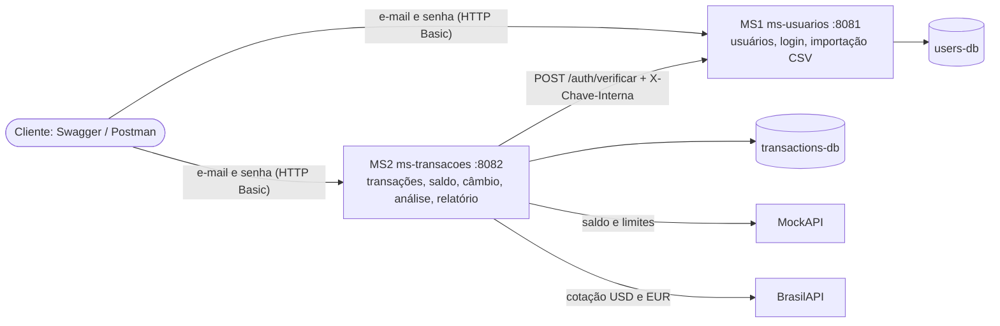
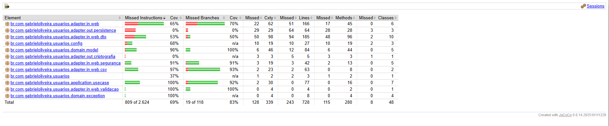
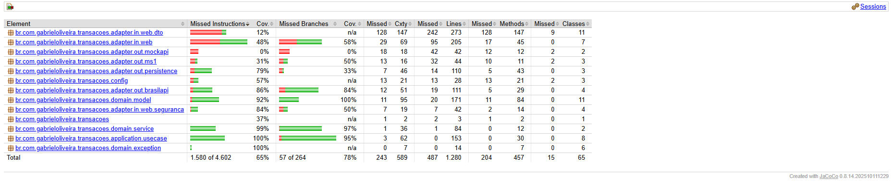

# Gestão Financeira — Desafio Beca Java 2026

API de finanças pessoais em **dois microsserviços Spring Boot**, em arquitetura hexagonal. O usuário se cadastra, registra depósitos, retiradas, transferências e compras, e o sistema aprova ou rejeita cada transação conforme o saldo e os limites da conta. Cada valor é mostrado em reais, dólar e euro. Também dá para ver os gastos por categoria, dia e mês, baixar um relatório em CSV para o Excel e cadastrar vários usuários de uma vez por arquivo.

**Autor:** Gabriel Oliveira Silva ([gdravk](https://github.com/gdravk)) · **Quadro Jira:** [DBJ2G](https://gdravk.atlassian.net/jira/software/projects/DBJ2G/boards/2?filter=&groupBy=none)

## Sumário

- [Tecnologias](#tecnologias)
- [Arquitetura](#arquitetura)
- [Como rodar](#como-rodar)
- [Variáveis de ambiente](#variáveis-de-ambiente)
- [Configurar a API Mock](#configurar-a-api-mock)
- [Endpoints](#endpoints)
- [Como autenticar](#como-autenticar)
- [Testando pelo Swagger, passo a passo](#testando-pelo-swagger-passo-a-passo)
- [Regras de negócio](#regras-de-negócio)
- [Importação de usuários por CSV](#importação-de-usuários-por-csv)
- [Relatório de transações em CSV](#relatório-de-transações-em-csv)
- [Formato dos erros](#formato-dos-erros)
- [Testes e cobertura](#testes-e-cobertura)
- [Decisões técnicas](#decisões-técnicas)
- [Evolução do projeto](#evolução-do-projeto)
- [Melhorias futuras](#melhorias-futuras)

## Tecnologias

- **Java 21** e **Spring Boot 4.1** (Web MVC, Data JPA, Validation, Security)
- **PostgreSQL 16**, um banco por microsserviço
- **Docker** e **Docker Compose**
- **springdoc-openapi** (Swagger)
- **JUnit 5**, **Mockito** e **JaCoCo** (cobertura)
- **BCrypt** para as senhas
- Serviços externos: **MockAPI** (saldo e limites da conta) e **BrasilAPI** (câmbio do Banco Central)

## Arquitetura



- **MS1 (`ms-usuarios`, porta 8081):** cadastro e manutenção de usuários, importação por CSV e a rota interna que confere e-mail e senha.
- **MS2 (`ms-transacoes`, porta 8082):** transações, saldo, câmbio, análise de despesas e relatório.
- Cada serviço tem o **próprio banco**; nenhum lê a tabela do outro. O MS2 só conhece o usuário pelo id que o MS1 devolve no login.

### Hexagonal nos dois serviços

O domínio é Java puro (sem Spring, JPA ou HTTP). Ele fala com o mundo por **portas** (interfaces), e os **adaptadores** implementam essas portas. Os casos de uso são criados no `BeanConfig`, sem anotações de Spring. Estrutura do MS2 (o MS1 segue o mesmo desenho):

```
br.com.gabrieloliveira.transacoes
├── domain                   regras de negócio, Java puro
│   ├── model                Transacao, SaldoConta, Cotacao, Periodo, RelatorioTransacoes...
│   ├── service              ValidadorDeTransacao (aprova/rejeita), AnalisadorDeDespesas
│   └── exception
├── application
│   ├── port.in              casos de uso (interfaces): CriarTransacaoUseCase, GerarRelatorioUseCase...
│   ├── port.out             o que o domínio precisa de fora: TransacaoRepositoryPort, SaldoContaPort, CambioPort, AutenticacaoPort
│   └── usecase              implementação dos casos de uso
├── adapter
│   ├── in.web               controllers, DTOs, tratamento de erros, segurança, gerador do CSV
│   └── out                  persistence (JPA), mockapi, brasilapi, ms1
└── config                   BeanConfig (liga portas e casos de uso), SecurityConfig, OpenApiConfig
```

No MS1, os adaptadores de saída são `persistence` (JPA) e `criptografia` (BCrypt, atrás da porta `SenhaEncoderPort`).

## Como rodar

### Com Docker (recomendado)

Pré-requisito: **Docker Desktop**. Não precisa ter Java instalado: a imagem compila o projeto.

```bash
git clone https://github.com/gdravk/beca-java2026-gdravk.git
cd beca-java2026-gdravk
cp .env.example .env        # depois preencha os valores (veja a tabela abaixo)
docker compose up -d --build
docker compose ps           # os 4 serviços devem aparecer como "healthy"
```

- Swagger do MS1: http://localhost:8081/swagger-ui.html
- Swagger do MS2: http://localhost:8082/swagger-ui.html

A primeira subida demora alguns minutos (baixa o Maven e as dependências). Para ver os logs: `docker compose logs -f ms-transacoes`. Para parar: `docker compose down` (os dados continuam); `docker compose down -v` apaga também os bancos.

### Pelo IntelliJ (para desenvolver)

Pré-requisito: Java 21.

1. Suba só os bancos: `docker compose up -d users-db transactions-db`.
2. Em cada Run Configuration (`MsUsuariosApplication` e `MsTransacoesApplication`), cadastre as variáveis do `.env` em **Environment variables**.
3. Rode primeiro o MS1 e depois o MS2.

Se os containers das aplicações estiverem ligados, pare-os antes (eles usam as mesmas portas): `docker compose stop ms-usuarios ms-transacoes`.

## Variáveis de ambiente

Todas ficam no arquivo `.env` (que não vai para o Git). O `.env.example` mostra os nomes.

| Variável | Usada por | O que é |
|---|---|---|
| `USERS_DB_NAME`, `USERS_DB_USER`, `USERS_DB_PASSWORD` | MS1 e `users-db` | nome do banco de usuários, usuário e senha |
| `TRANSACTIONS_DB_NAME`, `TRANSACTIONS_DB_USER`, `TRANSACTIONS_DB_PASSWORD` | MS2 e `transactions-db` | nome do banco de transações, usuário e senha |
| `MOCKAPI_BASE_URL` | MS2 | endereço do seu projeto no MockAPI, sem o `/accounts` no final (ex.: `https://xxxx.mockapi.io`) |
| `BRASILAPI_BASE_URL` | MS2 | opcional; padrão `https://brasilapi.com.br/api` |
| `MS1_CHAVE_INTERNA` | MS1 e MS2 | segredo que o MS2 manda ao MS1 para conferir logins; **o mesmo valor nos dois**, pelo menos 16 caracteres e diferente do valor de exemplo |
| `MS1_URL` | MS2 | opcional; padrão `http://localhost:8081` (no Docker o Compose já usa `http://ms-usuarios:8081`) |

O endereço dos bancos também vem de variáveis (`USERS_DB_HOST`/`PORT` e `TRANSACTIONS_DB_HOST`/`PORT`), mas não precisa preencher: o padrão é `localhost` e o Compose já coloca os nomes dos containers.

Se faltar uma variável obrigatória, o `docker compose` para na hora com a mensagem `defina ... no .env`.

## Configurar a API Mock

O saldo e os limites de cada usuário vêm de um recurso no [MockAPI](https://mockapi.io).

1. Crie um projeto e um recurso chamado **`accounts`** com os campos:
   ```json
   { "userId": 1, "saldo": 5000.00, "limiteDiario": 2000.00, "limitePorTransacao": 1000.00 }
   ```
2. Crie uma conta para cada usuário que vai movimentar dinheiro, com o `userId` igual ao **id do usuário no MS1**.
3. Coloque a URL do projeto (sem o `/accounts` no final) em `MOCKAPI_BASE_URL`.

O MS2 consulta `GET {MOCKAPI_BASE_URL}/accounts?userId={id}` e confere o `userId` exato (o filtro do MockAPI é por "contém": `?userId=1` também traria o 10 e o 11).

## Endpoints

Documentação completa, com exemplos, nos dois Swaggers. Todas as rotas exigem login, menos as marcadas como **aberta**.

**MS1 — usuários (porta 8081)**

| Método | Rota | O que faz |
|---|---|---|
| POST | `/users` | cadastra um usuário (**aberta**) |
| GET | `/users?pagina=0&tamanho=10` | lista os usuários, sem CPF (paginado) |
| GET | `/users/{id}` | dados completos da própria conta |
| PUT | `/users/{id}` | atualiza a própria conta (a senha é opcional) |
| DELETE | `/users/{id}` | exclui a própria conta |
| POST | `/users/import` | importa usuários de um arquivo CSV |
| POST | `/auth/verificar` | uso interno do MS2: confere e-mail e senha (exige o cabeçalho `X-Chave-Interna`) |

**MS2 — transações (porta 8082)**

| Método | Rota | O que faz |
|---|---|---|
| POST | `/transactions` | registra uma transação (responde 201 mesmo quando ela é rejeitada) |
| GET | `/transactions?inicio=&fim=&tipo=` | lista as transações do usuário (filtros opcionais) |
| GET | `/transactions/{id}` | uma transação, com o valor em reais, dólar e euro |
| POST | `/transactions/{id}/estorno` | estorna uma transação aprovada |
| GET | `/transactions/analysis/category` | despesas por categoria |
| GET | `/transactions/analysis/daily` | despesas por dia |
| GET | `/transactions/analysis/monthly` | despesas por mês |
| GET | `/transactions/report?inicio=&fim=` | baixa o relatório em CSV |
| GET | `/accounts/{usuarioId}/balance` | saldo e limites da própria conta (vindos da API Mock) |

Datas sempre no formato `aaaa-mm-dd`. Na análise e no relatório, sem datas vale o mês atual.

## Como autenticar

O login é por **autenticação básica (HTTP Basic)**: em cada chamada vão o e-mail e a senha de um usuário cadastrado no MS1.

- **No Swagger:** botão **Authorize** (cadeado no topo) → e-mail em *username*, senha em *password* → **Authorize** → **Close**. O login vale só para a página onde foi feito: faça nas duas (8081 e 8082).
- **No Postman:** aba **Authorization** → tipo **Basic Auth** → e-mail e senha.

O MS2 não tem usuários próprios: a cada chamada ele pergunta ao MS1 (`POST /auth/verificar`) se o e-mail e a senha conferem e recebe o id do usuário. Essa rota interna é protegida por uma chave que só o MS2 conhece (`MS1_CHAVE_INTERNA`), para ninguém usá-la para testar senhas.

Regras de acesso:

- Cada usuário só vê, altera e exclui a **própria** conta (outro id responde 403).
- Cada usuário só vê, cria, estorna e baixa as **próprias** transações. Pedir dados de outro usuário responde 403, e uma transação de outra pessoa responde 404, como se não existisse.
- A senha é gravada com BCrypt e nunca aparece em resposta nem em log.
- Login errado tem sempre a mesma mensagem e o mesmo tempo de resposta, exista o e-mail ou não: assim ninguém descobre quais e-mails estão cadastrados.

## Testando pelo Swagger, passo a passo

1. Abra http://localhost:8081/swagger-ui.html. Em **Usuarios → POST /users**, o corpo já vem com um exemplo; troque o e-mail e o CPF e clique em **Execute**. Anote o `id` da resposta (201).
2. Clique em **Authorize** e entre com o e-mail e a senha que você cadastrou.
3. No [MockAPI](#configurar-a-api-mock), crie a conta desse `id`.
4. Abra http://localhost:8082/swagger-ui.html e faça o **Authorize** de novo (com o mesmo e-mail e a mesma senha).
5. **Conta → GET /accounts/{usuarioId}/balance** com o seu id: mostra o saldo e os limites.
6. **Transacoes → POST /transactions**: o exemplo já é uma compra válida. Teste também:
   ```json
   { "tipo": "DEPOSITO", "valor": 1000.00, "descricao": "salário" }
   { "tipo": "COMPRA", "valor": 150.75, "categoria": "ALIMENTACAO", "descricao": "mercado" }
   { "tipo": "TRANSFERENCIA", "valor": 50.00, "usuarioDestinoId": 2, "descricao": "aluguel dividido" }
   { "tipo": "RETIRADA", "valor": 999999.00, "descricao": "saque grande" }
   ```
   A última volta com `"status": "REJECTED"` e o motivo (saldo insuficiente).
7. **GET /transactions/{id}** com o id de uma transação: o valor em reais, dólar e euro, com a cotação e a data dela.
8. **Analise de despesas** → as três rotas, sem preencher nada (mês atual).
9. **Relatorio → GET /transactions/report** → **Execute** → **Download file** → abrir no Excel.

## Regras de negócio

### Quando uma transação é aprovada ou rejeitada

Toda transação é **gravada**, aprovada (`APPROVED`) ou rejeitada (`REJECTED`, com o motivo). A rejeição é uma decisão de negócio, não um erro: a resposta é 201 nos dois casos.

1. **Dados:** valor maior que zero, compra precisa de categoria, transferência precisa de destino e não pode ser para a própria conta.
2. **Depósito** é aprovado direto, sem consultar o saldo.
3. **Saídas** (retirada, transferência e compra) consultam a API Mock e são rejeitadas quando:
   - o valor é maior que o **saldo**;
   - o valor passa do **limite por transação**;
   - a soma das saídas aprovadas do dia (horário de Brasília) mais esta passa do **limite diário**.
4. **API Mock fora do ar** (ou demorando mais de 3 segundos): a saída é rejeitada com o motivo "serviço de saldo indisponível". Nunca é aprovada às cegas.

Erro de **formato** (campo faltando, valor com 3 casas, tipo inexistente) não grava nada: responde 400 com a lista de campos.

### Correção sem apagar: estorno

Transação nunca é apagada nem alterada (não existe DELETE nem PUT). Para corrigir, `POST /transactions/{id}/estorno` cria uma **nova** transação do tipo inverso, ligada à original pelo `transacaoOriginalId`: uma saída volta como depósito e um depósito volta como retirada. Só transações aprovadas podem ser estornadas, uma vez só, e um estorno não pode ser estornado (409).

### O que conta como despesa (análise)

Saída **aprovada** (retirada, transferência enviada ou compra) que não é um estorno e que não foi estornada. Depósitos e rejeitadas ficam de fora. Os totais são em reais. Transação sem categoria entra como `OUTROS`.

### Câmbio (BrasilAPI)

- Cada transação mostra o valor em **reais, dólar (USD) e euro (EUR)**, com a taxa e a data da cotação.
- Cotação usada: a de **venda** do boletim mais recente do dia (`/cambio/v1/cotacao/{moeda}/{data}`). Em fim de semana e feriado, volta um dia por vez até achar (no máximo 7 dias).
- A taxa é **guardada na transação** quando ela é criada: o valor histórico fica certo, e a consulta não depende da BrasilAPI estar no ar.
- Se a BrasilAPI estiver fora na criação, a transação segue normalmente (o câmbio é só informativo) e a consulta tenta de novo depois. Se continuar fora, a resposta traz `"conversaoDisponivel": false` com uma mensagem.
- Cotações ficam 30 minutos em cache, e depois de uma falha o MS2 espera 1 minuto antes de tentar de novo, para não deixar cada transação esperando o timeout.

## Importação de usuários por CSV

`POST /users/import` (exige login), campo `file` do tipo arquivo. Formato: UTF-8, separador `;` e o cabeçalho `nome;email;cpf;senha`. Até 1000 usuários e 2 MB.

Cada linha passa pelas mesmas regras do cadastro. Uma linha com erro não impede as outras: a resposta conta quantas entraram e lista cada linha rejeitada com o motivo.

Arquivo de exemplo, com linhas inválidas de propósito: [`docs/exemplos/usuarios-exemplo.csv`](docs/exemplos/usuarios-exemplo.csv) (layout explicado em [`usuarios-exemplo.md`](docs/exemplos/usuarios-exemplo.md)).

## Relatório de transações em CSV

`GET /transactions/report?inicio=2026-11-01&fim=2026-11-30` baixa `relatorio-transacoes.csv` só com as transações do usuário logado, da mais antiga para a mais nova, e um resumo no fim (aprovadas, rejeitadas, total de depósitos e de saídas).

Feito para abrir direto no **Excel em português**: UTF-8 com BOM (os acentos não quebram), separador `;`, números com vírgula (`150,75`) e datas `dd/mm/aaaa`. Uma descrição que comece com `=`, `+`, `-` ou `@` é escrita como texto, para o Excel não executar como fórmula.

## Formato dos erros

Os dois serviços respondem os erros no mesmo formato:

```json
{
  "status": 400,
  "erro": "Bad Request",
  "mensagem": "existem campos invalidos na requisicao",
  "caminho": "/transactions",
  "campos": { "valor": "o valor deve ser maior que zero" },
  "dataHora": "2026-11-05T14:30:00"
}
```

`campos` só aparece nos erros de validação. Nenhum erro mostra o rastro interno do código (stack trace).

## Testes e cobertura

Os testes usam JUnit 5 e Mockito (as portas de saída são simuladas, então nenhum teste chama banco, API Mock ou BrasilAPI de verdade). A cobertura é medida pelo JaCoCo, que roda junto com o build.

Para rodar os testes e gerar o relatório, dentro da pasta de cada microsserviço:

```bash
# windows
mvnw.cmd clean verify
# linux / mac / git bash
./mvnw clean verify
```

O relatório fica em `target/site/jacoco/index.html` (abra no navegador).

O build também confere a cobertura: se o domínio ou os casos de uso ficarem com menos de 80% das linhas testadas, o `verify` falha e mostra qual pacote ficou abaixo.

Cobertura de linhas alcançada:

| Microsserviço | Domínio | Casos de uso | Total | Testes |
|---|---|---|---|---|
| ms-usuarios | 87,0% | 100% | 66,8% | 83 |
| ms-transacoes | 93,0% | 100% | 65,2% | 145 |

A tabela acima conta linhas. Os relatórios abaixo mostram também instruções (coluna "Cov." da esquerda) e ramos (`if`/`else`, coluna "Cov." da direita); por isso os totais aparecem um pouco diferentes.

**ms-usuarios**



**ms-transacoes**



Regras críticas cobertas:

- **ms-transacoes:** aprovação e rejeição de transação (valor zero ou negativo, compra sem categoria, transferência para si mesmo, saldo insuficiente, limite por transação, limite diário), API Mock fora do ar (a saída é rejeitada, nunca aprovada às cegas), cotações do dólar e do euro, análise de despesas (ignora rejeitadas, depósitos e estornos), câmbio que volta para o último dia com cotação (fim de semana e feriado), BrasilAPI fora do ar ou lenta, relatório CSV (formato do Excel, acentos e proteção contra fórmulas), validação das entradas e segurança.
- **ms-usuarios:** cadastro (e-mail duplicado, senha criptografada), busca de usuário inexistente (404), atualização com senha opcional, importação de CSV (linhas inválidas com motivo, arquivo vazio), validação das entradas e segurança.

## Decisões técnicas

- **Hexagonal nos dois serviços**, com o domínio em Java puro: as regras de aprovação e de despesa são testadas sem banco, sem HTTP e sem Spring.
- **Transação nunca é apagada:** a correção é um estorno, e o histórico fica completo.
- **Rejeição gravada e respondida com 201:** quem chama sempre recebe o id e o motivo, e a rejeição aparece no relatório.
- **Taxa de câmbio guardada na criação:** o valor histórico fica certo e a consulta não depende da BrasilAPI.
- **Login conferido no MS1:** só existe uma base de usuários, e a rota interna é protegida por uma chave compartilhada.
- **Horário de Brasília em todo o sistema** (um `Clock` no fuso `America/Sao_Paulo`): uma compra às 22h não cai no dia seguinte no limite diário, mesmo com o servidor em UTC.
- **Senha limitada a 72 bytes:** é o máximo que o BCrypt aceita (letra com acento ocupa 2 bytes).
- **Docker:** imagem em duas etapas (só o `.jar` vai para a imagem final), aplicação rodando sem ser root, *healthcheck* em todos os serviços, e o MS2 só sobe depois do MS1 pronto.

## Evolução do projeto

**Período:** de 29/10/2026 (início) a 09/11/2026 (conclusão).

Os requisitos chegaram em etapas, e o projeto foi se adaptando a cada uma:

| Data | O que chegou | O que mudou no projeto |
|---|---|---|
| 29/10/2026 | **Início:** desafio e guia passo a passo | Ponto de partida: MS1 em camadas, MS2 hexagonal, JWT como segurança principal. |
| 30/10/2026 | Desafio atualizado | O MS1 também passou a ser hexagonal (foi refatorado). JWT, Apache POI, Testcontainers e Azure viraram **bônus**. Jira organizado em épicos com tarefas de até um dia. |
| 30/10/2026 | Pedido do PO (9 pedidos) | Passou a ser a referência principal. Transação nunca é apagada (estorno no lugar do DELETE), login básico obrigatório, valor em pelo menos duas moedas, relatório que abre no Excel em português. |
| 03/11/2026 | 1ª revisão do professor | Uma branch e um PR por tarefa (nada direto na `main`), testes dos casos de uso com Mockito, e-mail normalizado, senha opcional na atualização. |
| 04/11/2026 | Alinhamento do professor | Um PR por funcionalidade completa, ajustes no mesmo PR e o formato da apresentação. |
| 05/11/2026 | 2ª revisão | Cache do câmbio e pausa após falha, horário de Brasília em todas as datas, rota interna do login protegida por chave, transação de outro usuário respondendo 404, listagem de usuários sem CPF. |
| 06/11/2026 | 3ª revisão | Senha com no máximo 72 bytes (limite do BCrypt) e a recusa da chave interna de exemplo na subida. Merge dos PRs #5 a #9. |
| 09/11/2026 | **Conclusão** | Testes das regras críticas com cobertura mínima no build, Swagger completo, relatório CSV para o Excel, ambiente inteiro no Docker Compose e este README. |

## Melhorias futuras

**Bônus do desafio que optei por não fazer**, priorizando entregar os 9 pedidos do PO completos e testados:

- **JWT** no lugar do login básico: o usuário faria login uma vez e mandaria um token, em vez de a senha ir em toda chamada (e o MS2 deixaria de consultar o MS1 a cada requisição).
- **Relatório e importação em Excel/PDF com Apache POI**, além do CSV.
- **Testes de integração com Testcontainers**, subindo um PostgreSQL de verdade nos testes.
- **Publicação no Azure**, com os containers na nuvem.
